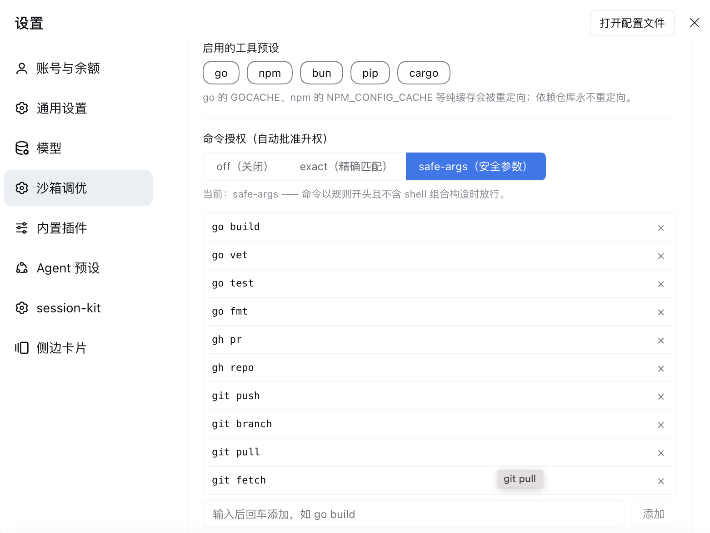
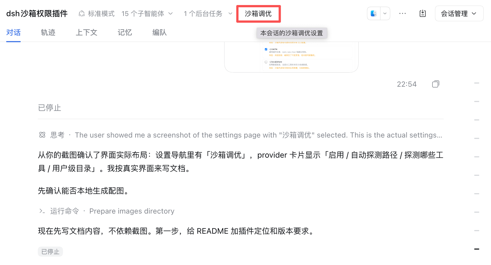
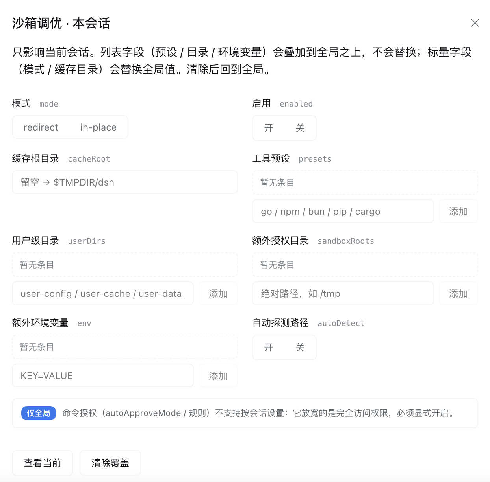

# dsh-sandbox-tune

**DeepSeek Harness（DSH）的沙箱调优插件** —— 让 `go build` / `go test` /
`npm install` 这类开发命令在沙箱内正常跑通，不再每次都弹提权审批窗。

DSH 的 `workspace-write` 沙箱只允许写「工作区 + `/tmp` + 临时目录」，
而构建工具的缓存、CLI 的配置目录都在工作区外，于是每条命令都被内核拒绝，
模型只能申请 `danger-full-access` 提权 —— 这就是弹窗的来源。

本插件从三个层面解决：**缓存重定向**、**可写目录授权**、**按规则自动批准升权**。

### 版本要求

| 项 | 要求 |
|---|---|
| DSH | `0.2.1-rc.2` 或更高（本插件在 `0.2.1-rc.2` 上开发与验证） |
| 运行平台 | macOS / Linux / Windows（能力有差异，见[平台支持](#平台支持)） |
| 依赖 | 使用 DSH 自带的 `dsh-bash-sandbox` / `dsh-sandbox-local` / `dsh-shell` 等，无需额外安装 |

插件通过 `dsh plugin add` 安装进 profile，随 DSH 版本升级自动跟随
（依赖以 `peerDependencies` 声明，由 DSH 运行时解析）。

---

## 目录

- [问题：为什么会有弹窗](#问题为什么会有弹窗)
- [功能总览](#功能总览)
- [两种工作模式](#两种工作模式)
- [安装](#安装)
- [全局配置](#全局配置)
- [会话级配置](#会话级配置)
- [命令授权规则](#命令授权规则)
- [作用域与优先级](#作用域与优先级)
- [配置热更新](#配置热更新)
- [安全回退](#安全回退)
- [平台支持](#平台支持)
- [验证](#验证)
- [已知限制](#已知限制)

---

## 问题：为什么会有弹窗

DSH 的文件沙箱（`workspace-write`）只允许写三个地方：

```
工作区目录  +  /tmp  +  用户临时目录($TMPDIR)
```

而构建工具默认把缓存写到工作区之外：

| 工具 | 默认位置 | 在沙箱内 |
|---|---|---|
| Go 编译缓存 `GOCACHE` | `~/Library/Caches/go-build` | ❌ 拒绝写 |
| Go 模块缓存 `GOMODCACHE` | `~/gvm/.../pkg/mod` | 读 ✅ / 写 ❌ |
| npm `NPM_CONFIG_CACHE` | `~/.npm` | ❌ 拒绝写 |
| Cargo `CARGO_HOME` | `~/.cargo` | ❌ 拒绝写 |

于是每条编译命令都被内核拒绝（macOS Seatbelt 报 `Operation not permitted`），
模型只能申请 `danger-full-access` 提权 —— 这就是弹窗的来源。

实测对比（同一沙箱内）：

```
GOCACHE=~/Library/Caches/go-build  go build ./...   → exit 1（operation not permitted）
GOCACHE=$TMPDIR/dsh/go-build       go build ./...   → exit 0 ✅
```

## 功能总览

本插件针对四类弹窗，按占比排列（基于本机 517 次历史审批统计）：

| 弹窗原因 | 占比 | 本插件的解法 |
|---|---|---|
| Go 等构建缓存写不进去 | 28% | 缓存重定向 / 原地授权 |
| 写工作区外的用户配置目录（`~/.config` 等） | 27% | 用户级目录预设 |
| `gh` 读钥匙串 | 19% | ❌ 不支持（非文件路径问题） |
| 写 `~/.dsh` 的 profile 配置 | 11% | 部分（可用 `sandboxRoots` 授权） |
| 其余（进程管理、删除清理等） | 15% | ❌ 不适合用白名单放宽 |

### 三个能力模块

| 模块 | 作用 | 作用域 |
|---|---|---|
| **缓存处理** | 把纯缓存重定向，或授权真实缓存目录 | 全局 + 会话 |
| **可写目录授权** | 把用户级目录加入沙箱白名单 | 全局 + 会话 |
| **命令授权** | 按规则自动批准沙箱升权 | **仅全局** |

## 两种工作模式

`mode` 决定缓存怎么处理。**只在执行器（`sandbox-tune-bash`）上配置一处**，
provider 会自动跟随。

| 模式 | 做法 | 与终端共用缓存 | 后端要求 |
|---|---|---|---|
| **`redirect`**（默认） | 用环境变量把纯缓存指到 `$TMPDIR/dsh` | ❌ 两套独立 | 任何后端 |
| **`in-place`** | 路径不变，把真实缓存目录授权为可写 | ✅ 完全共用 | Seatbelt / bwrap |

**为什么默认 `redirect`**：它只依赖环境变量，任何平台都能用，不需要沙箱
支持追加白名单。

**什么时候用 `in-place`**：想与普通终端共用同一份缓存（避免冷启动、不重复占
磁盘）。代价是依赖沙箱后端能力 —— 不支持时会自动回退到 `redirect`。

### 一个必须区分的前提

缓存分两类，可重定向性**完全不同**：

| 类型 | 例子 | 丢了会怎样 | 处理方式 |
|---|---|---|---|
| **纯缓存**（`cache`） | `GOCACHE`、`NPM_CONFIG_CACHE`、`PIP_CACHE_DIR` | 只是变慢 | 可重定向 |
| **依赖仓库**（`store`） | `GOMODCACHE`、`CARGO_HOME` | **编译直接失败** | 只可原地授权 |

把 `GOMODCACHE` 指到空目录，`go build` 会立刻报「找不到模块」，**比弹窗更糟**。
所以 `redirect` 模式只动 `cache` 类；`store` 类只在 `in-place` 下被授权。

## 安装

```sh
dsh plugin --profile web add link:/path/to/dsh-sandbox-tune
```

或把它加入 profile 的 `dsh.profile.bundles`。插件自带 `cordis.patch.yml`，
会自动禁用 base 的 `bash-sandbox` / `pwsh-sandbox` / `sandbox` 三行并替换成
自己的实现（同名服务不能重复注册，所以原行必须禁用）。


## 全局配置

全局配置对所有会话生效。有两种改法：**图形界面**（推荐）或直接改 YAML。

**两种方式都无需重启 DSH** —— 插件自己监听 `cordis.patch.yml`，改动会自动
重读并生效（详见[配置热更新](#配置热更新)）。

### 界面操作

**入口**：左侧栏底部「设置」→ 导航里的「**沙箱调优**」。


页面顶部有一个蓝色的「**全局**」徽标，明确说明本页修改的是全局配置：

> 本页修改的是全局配置，对所有会话生效。想只改当前会话，请用会话标题右侧的
> 「沙箱调优」按钮，或输入 `/sandbox-tune`。

**卡片一：执行器**（`sandbox-tune-bash`）

决定缓存写到哪里。

| 控件 | 对应字段 | 说明 |
|---|---|---|
| 启用 | `enabled` | 关闭后完全退化为原生执行器 |
| 模式 | `mode` | `redirect`（重定向）/ `in-place`（原地授权） |
| 缓存根目录 | `cacheRoot` | 仅 redirect 模式可用；留空 → `$TMPDIR/dsh` |
| 启用的工具预设 | `presets` | 点选 go / npm / bun / pip / cargo |

选 `in-place` 时，「缓存根目录」输入框会自动禁用并变灰 —— 因为该模式下路径
保持不变，不需要指定。

**卡片二：命令授权**



| 控件 | 对应字段 | 说明 |
|---|---|---|
| 模式 | `autoApproveMode` | `off` / `exact` / `safe-args` |
| 规则列表 | `autoApproveCommands` | 逐条添加，每行右侧 `×` 可删除 |

规则用「输入框 + 添加按钮」维护，回车也能添加。已添加的规则显示为表格行，
超长会自动省略（悬停看全文）。模式为 `off` 时输入框禁用。

**卡片三：沙箱 provider**


把真实缓存目录和用户级目录追加进沙箱可写白名单。

| 控件 | 对应字段 | 说明 |
|---|---|---|
| 启用 | `enabled` | 关闭后完全不改沙箱边界 |
| 自动探测路径 | `autoDetect` | 跑 `go env` 等只读命令拿真实路径 |
| 探测哪些工具 | `presets` | 点选要探测的工具 |
| 用户级目录 | `userDirs` | 勾选后加入白名单，每项都标了收益与风险 |

**保存**：改动即时写入，无需点「保存」按钮。若想放弃改动，用页面右上角的
「打开配置文件」直接编辑 YAML，或重新加载页面。

> 界面里的控件状态会反映当前值。例如上面截图里 `~/.cache` 已勾选、
> `~/.config` 未勾选 —— 这就是当前的授权状态。

### 直接改 YAML

配置写在 profile 的 `cordis.patch.yml`。下面是三个卡片的完整字段。

#### 执行器（`sandbox-tune-bash`）

```yaml
- id: sandbox-tune-bash
  name: 'dsh-sandbox-tune/executor'
  config:
    enabled: true
    mode: redirect            # redirect | in-place
    cacheRoot: ''             # 仅 redirect 用；空 → $TMPDIR/dsh
    presets: [go, npm, bun, pip]
    env: {}                   # 额外/覆盖环境变量
    autoApproveMode: off      # off | exact | safe-args
    autoApproveCommands: []
```

| 字段 | 默认 | 含义 |
|---|---|---|
| `enabled` | `true` | 总开关；`false` 时完全退化为原生执行器 |
| `mode` | `redirect` | 见[两种工作模式](#两种工作模式) |
| `cacheRoot` | `$TMPDIR/dsh` | 仅 redirect 模式使用，支持 `~` |
| `presets` | `['go']` | 启用哪些工具的缓存预设 |
| `env` | `{}` | 追加或覆盖的环境变量，优先级最高 |
| `autoApproveMode` | `off` | 命令授权模式，见[命令授权规则](#命令授权规则) |
| `autoApproveCommands` | `[]` | 命令授权规则列表 |

> **`cacheRoot` 放哪？** 默认在 `$TMPDIR` 下，好处是无需额外授权就能写；
> 代价是 macOS 会周期性清理临时目录，重启后首次编译要冷启动。
> 想持久化就改成工作区内路径（如 `cacheRoot: .dsh/cache`，记得加 `.gitignore`），
> 或者直接切到 `in-place`。

#### provider（`sandbox-tune-provider`）

```yaml
- id: sandbox-tune-provider
  name: 'dsh-sandbox-tune/provider'
  config:
    enabled: true
    autoDetect: true          # 自动探测真实路径
    presets: [go, npm, bun, cargo]
    sandboxRoots: []          # 手工追加的额外目录
    userDirs: []              # 用户级目录预设，默认全不授权
```

| 字段 | 默认 | 含义 |
|---|---|---|
| `enabled` | `true` | `false` 时完全不改沙箱 |
| `autoDetect` | `true` | 跑 `go env` / `npm config get cache` 等探测真实路径 |
| `presets` | `['go']` | 要探测哪些工具 |
| `sandboxRoots` | `[]` | 手工追加的额外目录，支持 `~` |
| `userDirs` | `[]` | 用户级目录预设，见下 |

### 自动探测为什么必要

本机用 gvm 管理 Go，`GOMODCACHE` 在 `~/.gvm/pkgsets/go1.26.0/global/pkg/mod`，
而静态默认值会猜 `~/go/pkg/mod` —— **猜错就会授权一个不存在的目录，等于没授权**。

探测命令（都是只读，Host 侧执行，不受沙箱限制）：

| 预设 | 探测命令 |
|---|---|
| `go` | `go env GOCACHE` / `go env GOMODCACHE` |
| `npm` | `npm config get cache` |
| `bun` | `bun pm cache` |
| `pip` / `cargo` | 无探测，用静态默认值 |

探测失败时回落到静态默认值，单个工具失败不影响其他工具。

### 用户级目录预设

| 预设 | 目录 | 收益 | 风险 |
|---|---|---|---|
| `user-config` | `~/.config` | CLI 配置目录，最常见来源 | 可读写所有 CLI 配置 |
| `user-cache` | `~/.cache` | 通用缓存（npm/pip/bun） | 较低，缓存可被篡改 |
| `user-data` | `~/.local/share` | 应用数据 | 可修改应用数据，含数据库 |
| `user-state` | `~/.local/state` | 运行状态与日志 | 较低，可被伪造 |

**默认全部关闭**：放宽文件写入边界是有代价的，必须显式勾选。

> `user-cache` 刻意**不用** macOS 的 `~/Library/Caches`：那是系统级缓存
> （本机实测 5.9GB，含 Docker / AndroidStudio / CloudKit），远超「工具缓存」
> 的范围。只用 XDG 风格的 `~/.cache`。

## 会话级配置

同一台机器上不同会话可以有不同设置：做实验时放宽，动生产代码时收紧。

### 入口一：会话头部按钮

会话标题右侧有「**沙箱调优**」按钮：



点击后弹出 Modal，只影响当前会话：



弹窗顶部的说明写清了作用域规则：

> 只影响当前会话。列表字段（预设 / 目录 / 环境变量）会**叠加**到全局之上，
> 不会替换；标量字段（模式 / 缓存目录）会**替换**全局值。清除后回到全局。

**8 个可改字段**，两列布局，每个字段旁标注了对应的配置键：

| 字段 | 控件形态 | 说明 |
|---|---|---|
| 模式 `mode` | 二选一按钮 | redirect / in-place |
| 启用 `enabled` | 二选一按钮 | 开 / 关 |
| 缓存根目录 `cacheRoot` | 文本框 | 回车提交 |
| 工具预设 `presets` | 列表 + 添加 | 逗号分隔也支持 |
| 用户级目录 `userDirs` | 列表 + 添加 | 同上 |
| 额外授权目录 `sandboxRoots` | 列表 + 添加 | 绝对路径 |
| 额外环境变量 `env` | 列表 + 添加 | `KEY=VALUE` |
| 自动探测路径 `autoDetect` | 二选一按钮 | 开 / 关 |

**列表字段的交互**：输入框输入后回车（或点「添加」）→ 已添加项显示为表格行，
每行右侧 `×` 删除。重复项自动忽略。空列表显示「暂无条目」。

**底部操作**：

| 按钮 | 作用 |
|---|---|
| 查看当前 | 在会话流里打印生效配置，**标出每个值来自会话还是全局** |
| 清除覆盖 | 清空本会话的全部覆盖，回到全局配置 |

弹窗底部还有一条「**仅全局**」提示，说明命令授权两项不支持会话级设置。

**关闭方式**：右上角 `×`、点击遮罩、按 `Escape`。

> 每次增删都**立即提交**给 Host，没有「保存」按钮。这样界面显示与真实配置
> 始终一致 —— 本地暂存会让你以为改了，实际没生效。

### 入口二：斜杠命令

```
/sandbox-tune                                  查看本会话生效配置
/sandbox-tune set mode in-place                改模式
/sandbox-tune set presets go,npm               改预设
/sandbox-tune set cacheRoot /tmp/my-cache      改缓存目录
/sandbox-tune set env A=1,B=2                  追加环境变量
/sandbox-tune reset                            清除本会话覆盖
```

### 命令语法

| 值的类型 | 语法 | 例子 |
|---|---|---|
| 字符串 | 原样（支持空格） | `set cacheRoot /Users/k/Library/Application Support/x` |
| 布尔 | `true` / `false` | `set enabled false` |
| 数组 | 逗号分隔 | `set presets go,npm,bun` |
| 对象 | `KEY=VALUE`，逗号分隔 | `set env A=1,B=2` |

非法值会在写入前被拒绝，不会留下半条配置。

### 会话级不能改的字段

`autoApproveMode` 与 `autoApproveCommands` **只能全局设置**：

它们放宽的是 `danger-full-access` 升权。如果允许按会话设置、并随 fork 或
恢复历史会话带过去，你可能几天后完全不记得那个会话开着宽松规则。

写入时会直接报错（不是「存进去但不生效」——后者更难排查）。

### 覆盖存在哪

进程内 Map（按 sessionId 键）。**进程重启后回到全局配置** ——
这个退化方向是安全的，不会意外保留宽松设置。

## 命令授权规则

有些弹窗靠放宽路径解决不了（命令要写工作区外的任意位置）。本插件提供
**命令级自动批准**，但安全边界必须说清楚。

### 它放行的是什么

自动批准的是 `danger-full-access` **升权** —— 放行后整条命令不受文件沙箱限制。
而 bash 命令是任意 shell 程序：

```
go build ./...                        ← 你想放行的
go build ./... && rm -rf ~/Documents  ← 危险，但前缀一模一样
```

所以**不提供前缀通配**，只提供两种模式：

| 模式 | 判定规则 | 安全性 | 实用性 |
|---|---|---|---|
| `off`（默认） | 一律不放行 | — | — |
| `exact` | 命令与规则**逐字符相同**（忽略首尾空白） | 最高 | 低 |
| `safe-args` | 按 `&&` `\|\|` `;` `\|` 拆段，**每段都须匹配规则**；重定向与命令替换整体拒绝 | 中高 | 较高 |

`safe-args` 与 `exact` 的差别：前者允许命令带不同参数
（`go build` 规则能匹配 `go build ./...`），后者必须完全相同。

### safe-args 如何判定

分两步：

**第一步：拒绝不可拆分的构造**

| 构造 | 用途 | 为什么拆分也救不了 |
|---|---|---|
| `>` `<` | 重定向（写文件 / 读文件） | `cmd > ~/.zshrc` 拆开看 `cmd` 放行，但实际改写配置 |
| `` ` `` `$(` | 命令替换 | 内容无法静态校验，可塞任意命令 |
| `${` | 变量展开 | 同上，可注入 |
| `&` | 后台执行 | 脱离等待，输出与退出码都拿不到 |

**例外：不写文件的重定向放行**

以下两类重定向不碰文件系统，**自动放行**：

| 形态 | 例子 | 为什么安全 |
|---|---|---|
| fd 复制 | `2>&1`、`1>&2`、`>&2` | 只把 stderr 并到 stdout（或反之），改变的是输出流向 |
| 写 `/dev/null` | `2>/dev/null`、`> /dev/null`、`>>/dev/null` | /dev/null 是黑洞设备，写入即丢弃 |

所以 `git push 2>&1 | tail -3` 可以自动放行。

仍然拒绝的（会碰文件系统）：

| 形态 | 风险 |
|---|---|
| `> file` / `>> file` | 覆盖或追加任意文件（`> ~/.zshrc` 改写 shell 配置） |
| `> /dev/sda` | 写入设备，会破坏磁盘 |
| `< file` | 读取任意文件 |
| `2>&1 > out.txt` | 前半安全、后半危险，整体拒绝 |

判定顺序是**先剥离安全重定向，再看剩余部分** —— 否则 `2>&1 > out.txt`
里的 `>` 会被笼统判成危险，而 `2>&1` 单独出现时也会被误拒。

**第二步：按 `&&` `||` `;` `|` 拆分，逐段匹配规则**

**每一段都必须在规则里**，整条命令才放行：

| 命令 | 规则 `go build, go test` | 结果 |
|---|---|---|
| `go build ./...` | ✅ 命中 | 放行 |
| `go build && go test` | ✅ 两段都命中 | **放行** |
| `go build \|\| go test` | ✅ 两段都命中 | **放行** |
| `go build ; go test` | ✅ 两段都命中 | **放行** |
| `go build && rm -rf /` | ❌ 第二段未命中 | 弹窗 |
| `go build \| sh` | ❌ `sh` 未命中 | 弹窗 |

管道两段都要放行：`go build \| tee log` 需要规则里有 `go build` **和** `tee`。

拒绝时会指出**具体哪一段没通过**，便于判断是漏配规则还是命令本身有问题。

> **引号内的分隔符会被误拆**（`echo "a && b"` 会拆成两段）。这个误判方向是
> **更严格**（多一段要匹配规则，可能被拒），不会放行本该拒绝的命令。
> 保守方向正确，就不需要写一个容易出错的 shell 词法分析器。

### 重定向为什么不看目标路径

`>` `<` 一律不放行，**即使目标目录可写**：

```
go build > ./out.log      → 不放行
go build > /tmp/out.log   → 不放行
go build < ./input.txt    → 不放行
```

原因是**两个层面的事不能混**：

| 层面 | 判断依据 | 由谁负责 |
|---|---|---|
| 能不能写这个路径 | 沙箱白名单 | `sandboxRoots` / `userDirs` |
| 要不要升权 | 命令内容 | 命令授权规则 |

如果规则要判断“目标目录有没有权限”，就得解析命令并解析出目标路径 —— 而重定向
路径可以写成任意形式，静态分析无法可靠判断：

```
go build > ./out.log
go build > ../out.log
go build > /tmp/../etc/passwd
go build > $(echo /tmp)/out.log
```

判错就是放行任意文件写入。

#### 这不会带来额外弹窗

重定向本身**不触发审批**。只有目标真的被沙箱拒绝时，才会产生审批请求：

```
go build > /tmp/r1.log    → 直接成功，无审批请求（/tmp 本来可写）
go build > ~/x.log        → 被拒 → 产生审批 → 规则不放行 → 弹窗
```

所以规则不放行重定向，不会让「本来能过的命令」多弹一次。

#### 想让某个目录可写，正确做法是授权目录

| 做法 | 效果 | 粒度 |
|---|---|---|
| 把目录加到 `sandboxRoots` / `userDirs` | 写入不再被拒 → **根本不弹窗** | 该目录可写 |
| 在规则里放行重定向命令 | 仍需逐条匹配，且路径判不准 | 该命令可执行 |

**授权目录才是正解** —— 粒度是「这个目录可写」，比「这条命令可执行」精确得多，
而且不会因为命令写法变化而失效。

### 规则匹配细节

| 规则 | 能匹配 | 不能匹配 |
|---|---|---|
| `go build` | `go build`、`go build ./...`、`go build -v` | `go buildx`、`gofmt` |
| `go test ./internal/...` | 完全相同的命令 | `go test ./other/...` |

规则后面必须跟**空白**才算命中，避免 `go` 误匹配 `google-chrome`。

### 配置示例

```yaml
- id: sandbox-tune-bash
  config:
    autoApproveMode: safe-args
    autoApproveCommands:
      - go build
      - go vet
      - go test
```

### 只作用于沙箱升权

判定条件之一是审批原因以 `escalate sandbox to` 开头。其他审批（hook 的权限
请求等）一律交回原链，不擅自放行。

### 每次放行都留日志

```
sandbox-tune: 自动批准升权 "go build ./..."（规则 "go build"）
```

审计需要，不是可选项。

## 作用域与优先级

### 优先级

```
会话覆盖  >  全局配置  >  内置默认
```

按字段独立判断，不是整块覆盖。例如会话只改了 `mode`，其余字段仍用全局值。

### 叠加还是替换

| 字段 | 会话级行为 |
|---|---|
| `presets` / `userDirs` / `sandboxRoots` | **叠加**（合并去重，全局在前） |
| `env` | **按 key 合并**（同名 key 会话优先） |
| `mode` / `enabled` / `cacheRoot` / `autoDetect` | **替换**（标量无叠加概念） |

例如全局 `sandboxRoots: [/A]`，会话加 `/B`，最终生效是 `[/A, /B]` —— 两个都可写。

> **叠加的固有限制**：会话无法「移除」某个全局项。想移除只能去改全局配置。
> 这是选择叠加语义时接受的取舍（相比整体替换，叠加更符合直觉，也不会让
> 全局授权静默失效）。

### 字段作用域总表

| 字段 | 全局 | 会话级 | 会话级语义 |
|---|---|---|---|
| `mode` | ✅ | ✅ | 替换 |
| `enabled` | ✅ | ✅ | 替换 |
| `cacheRoot` | ✅ | ✅ | 替换 |
| `autoDetect` | ✅ | ✅ | 替换 |
| `presets` | ✅ | ✅ | 叠加 |
| `userDirs` | ✅ | ✅ | 叠加 |
| `sandboxRoots` | ✅ | ✅ | 叠加 |
| `env` | ✅ | ✅ | 合并 |
| `autoApproveMode` | ✅ | ❌ | — |
| `autoApproveCommands` | ✅ | ❌ | — |

## 配置热更新

改配置文件后**不需要重启 DSH**。插件会监听 `cordis.patch.yml`，变化时自动
重读本插件的 config 段并重建配置对象。

### 生效范围

| 改动类型 | 是否热更新 | 说明 |
|---|---|---|
| 规则（`autoApproveCommands`） | ✅ | 下一条命令立即生效 |
| 模式（`mode`） | ✅ | |
| 预设、目录（`presets` / `sandboxRoots` / `userDirs`） | ✅ | |
| 开关（`enabled` / `autoDetect`） | ✅ | |
| 启用/禁用插件、增删 loader 行 | ❌ **需重启** | 涉及加载新模块，本质无法热替换 |
| 插件源码（`.js`） | ❌ **需重启** | 同上 |

### 与设置页的关系

热更新只改**执行器实际使用的配置**，不推送界面更新。设置页的显示值来自
`entry.fiber.config`，而 `describe()` 每次调用都实时读该对象（无缓存），
所以**下次打开设置页看到的就是最新值**。

两者互不干扰：

| 操作 | 作用 |
|---|---|
| 改文件 | 触发热更新，执行器立即用新值 |
| 设置页保存 | 写入文件 → 同样触发热更新 |

> **注意并发操作**：如果设置页打开期间有人在外部改了文件，保存时会因
> revision 不匹配而失败（`SettingsConflictError`）。重新打开设置页再改即可。
> 这不是缺陷，是乐观并发控制。

### 失败时保留旧配置

配置写错不会让插件失效：

| 情况 | 行为 |
|---|---|
| YAML 语法错误 | 保留上一次有效配置，日志告警 |
| 字段值非法（如 `mode: bogus`） | 同上 |
| 该行被删除或禁用 | 不动配置（这种情况本来需要重启） |

这个设计是有意的：一次手误不该让你在不知情的情况下失去沙箱保护。

### 为什么不直接用 DSH 的 HMR

DSH 的 `dsh-hmr` 确实会监听 profile 的 patch 文件，但它构造时有硬性检查：

```js
if (!this.ctx.loader.internal) throw new Error("--expose-internals is required for HMR service")
```

而 `dsh web` 默认不带 `--expose-internals`（该参数也不能经 `NODE_OPTIONS` 传入，
Node 会拒绝）。实测即使手动用 `node --expose-internals bin.js` 启动，配置改动
仍不触发重载。

与其依赖一条需要改启动参数、且用到 Node 内部 API 的链路，不如插件自己监听：
只需 `fs.watch`，不碰内部 API，失败也只影响本插件。

### 实现要点

- **监听父目录**而非文件本身：编辑器「原子保存」会 unlink 再 create，
  盯着文件会丢事件。
- **内容去重**：`fs.watch` 可能对未改动的内容触发事件，用上次文本比对过滤。
- **防抖 300ms**：编辑器保存常触发多次事件，合并成一次。
- **不引入 YAML 库**：`link:` 安装的插件在 Node 模块解析时不回溯到 profile 的
  `node_modules`，`import 'yaml'` 在真实运行时是 `ERR_MODULE_NOT_FOUND`
  （实测踩过，启动日志报 `failed to import` 导致插件完全不激活）。
  改为按缩进扫描 + 自己解析标量，config 段的取值形态有限，够用且零依赖。
- **不用 `fiber.update()` 同步配置**：它会走到 `this.restart()` 重启插件
  （见 cordis 的 `Fiber.update`，waterfall 终态是 restart），而 restart 会
  销毁并重建 watcher，可能引发重复触发。改为直接赋值 `fiber.config` ——
  只换引用，`state` 保持 active，不触发任何生命周期。

## 安全回退

`in-place` 依赖后端能追加写白名单：

| 后端 | 支持 | 原因 |
|---|---|---|
| macOS Seatbelt | ✅ | 追加 `(allow file-write* (subpath ...))` |
| Linux bwrap | ✅ | 追加 `--bind` |
| Linux Landlock | ❌ | 授权由带版本的 launcher 内部拼装，无法外部注入 |
| Windows ACL | ❌ | 授权是 SID（`--write-sid`），由 provider 内部物化 ACE |

遇到不支持的后端时，执行器**自动回退到 `redirect`**，而不是停在
「既不授权也不重定向」的中间状态 —— 那种状态下缓存仍写不进去，构建直接失败，
比弹窗更糟。

## 平台支持

| 能力 | macOS | Linux | Windows |
|---|---|---|---|
| `redirect` 模式 | ✅ | ✅ | ✅ |
| `in-place` 模式 | ✅ | ✅ | ❌ 自动回退 |
| 命令授权 | ✅ | ✅ | ✅ |
| 用户目录预设 | ✅ | ✅ | ✅ |

### 平台相关的路径约定

| 用途 | macOS | Linux | Windows |
|---|---|---|---|
| 缓存根 | `$TMPDIR/dsh` | `/tmp/dsh` | `%TEMP%\dsh` |
| 配置目录预设 | `~/.config` | `~/.config` | `%APPDATA%` |
| 缓存目录预设 | `~/.cache` | `~/.cache` | `%LOCALAPPDATA%` |
| 应用数据预设 | `~/.local/share` | `~/.local/share` | `%LOCALAPPDATA%` |

### 平台分支如何选择

`cordis.patch.yml` 同时禁用 `bash-sandbox` 与 `pwsh-sandbox`（两者都注册
`ctx.shell`），再由本插件按平台接管：

```js
const SandboxExecutorBase = process.platform === 'win32'
  ? SandboxPwshExecutor   // Windows 跑 PowerShell
  : SandboxBashExecutor   // 其余平台跑 bash
```

如果一律继承 bash 版本，Windows 上的 shell 会去跑 `bash -c`，而 Windows
通常没有 bash —— 那会把功能弄坏，比不支持更糟。

## 验证

```sh
# 单元测试（纯函数，任何环境可跑）
node --test test/*.test.mjs

# 集成测试（最后一项需要进程本身未被沙箱限制）
node test/integration.mjs
```

集成测试最后一项会在真实沙箱里跑 `go build`。**如果在 DSH 会话里执行**，
测试进程自身已被 Seatbelt 限制，无法嵌套 `sandbox-exec`，该项会标记 SKIP
并说明原因 —— 请在普通终端重跑。

## 已知限制

- 只处理**文件写入**。`gh` 读钥匙串是 mach 端口访问，`open` 是 LaunchServices，
  这些不是文件路径问题，白名单解决不了。
- `redirect` 模式下 `go mod tidy` / `go get` 仍会因要写 `GOMODCACHE` 失败；
  需要切到 `in-place`，或单独放行一次。
- `in-place` 的授权是**整目录可写**。授权 `GOMODCACHE` 意味着沙箱内进程可以
  修改你的模块缓存，请自行权衡。
- 会话级覆盖**不跨进程重启保留**。
- 叠加语义下会话无法移除全局项。
- 注入对所有命令生效（不按命令内容判断），因为判断一段 shell 语法到底
  调用哪个工具并不可靠（`make test`、`./build.sh` 里都可能有 go）。

## 许可

MIT
